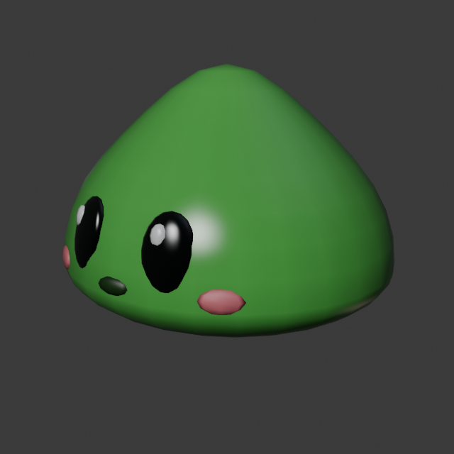
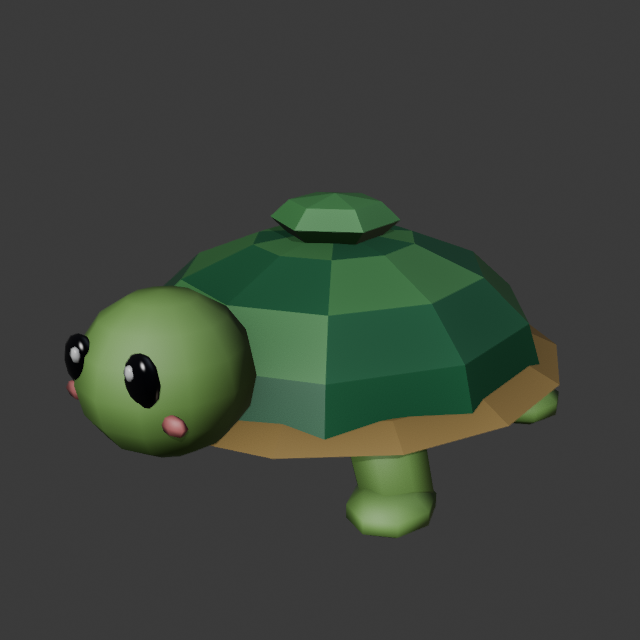
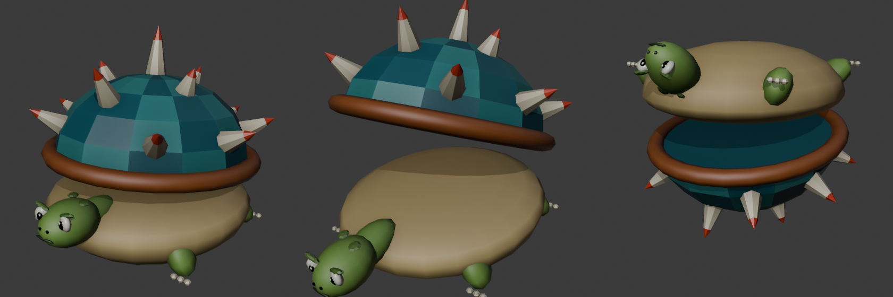

# ใส่โมเดล 3D ให้ตัวละคร มอน และต้นไม้

เกมจะมองหาโมเดลในโฟลเดอร์ `Assets/Resources/Models` ตามชื่อไฟล์ ถ้าเจอก็ใช้โมเดลนั้นพร้อมท่าทาง ถ้าไม่เจอก็ใช้รูปทรงเดิม
จึงทยอยใส่ทีละตัวได้ ไม่ต้องครบทีเดียว

| ชื่อไฟล์ prefab | ใช้กับ |
|---|---|
| `Player` | ตัวละครของเรา (ใช้กับทุกคลาส ถ้าไม่ได้ใส่โมเดลแยกคลาส) |
| `Knight` / `Mage` / `Archer` | โมเดลแยกตามคลาส (ถ้ามี จะใช้แทน `Player`) |
| `Slime` | มอนโซน Lv1 (มีโมเดลของเราเองแล้ว `Slime_Rigged.fbx`) |
| `Goblin` | มอนโซน Lv5 |
| `Orc` | มอนโซน Lv10 |
| `Golem` | มอนโซน Lv20 |
| `Pet` | สัตว์เลี้ยงของผู้เล่น (เต่า `Pet_Rigged.fbx`) |
| `Turtle` | มอนโซน Lv3 (TurtleShell หนามแหลม `Turtle_Rigged.fbx`) |
| `Tree` | ต้นไม้ในแผนที่ |

โค้ดจะปรับขนาดโมเดลให้พอดีเอง และหาท่าทางจากชื่อคลิป (idle, run/walk, attack, hit, die) ให้เอง
ถ้าโมเดลมี **Animator** พร้อมท่าทาง (แพ็กตัวละครส่วนใหญ่มี) จะใช้ท่าของแพ็ก
ถ้าเป็นโมเดลเปล่าไม่มีท่าทาง (เช่นไฟล์ .obj) เกมจะขยับให้เองแบบง่ายๆ คือ กระโดดเหยาะตอนเดิน พุ่งตอนตี สะดุ้งตอนโดนตี และล้มตอนตาย

## Goblin, Orc และ Golem มีมาให้แล้วในโปรเจกต์นี้
โฟลเดอร์ `Assets/Resources/Models/Goblin`, `Orc` และ `Golem` มีโมเดล low-poly พร้อมวัสดุ URP อยู่แล้ว (Orc ตาแดงเรืองแสงถือขวาน, Golem มีคริสตัลเรืองแสง)
1. คัดลอกโฟลเดอร์ `Assets/Resources` ทั้งโฟลเดอร์ ไปวางทับใน `Assets` ของโปรเจกต์ Unity
2. ถ้าเคยตั้ง prefab ชื่อ `Goblin` `Orc` หรือ `Golem` ไว้ใน `Resources/Models` (เช่น TurtleShell) ให้ลบหรือเปลี่ยนชื่อทิ้ง ไม่งั้นเกมจะหยิบตัวเก่าก่อน
3. กด Play แล้วเดินไปโซนซ้ายบน (Goblin Lv5) ขวาบน (Orc Lv10) หรือด้านหลัง (Golem Lv20)

## ขั้นที่ 1: เอาแพ็กฟรีจาก Asset Store
1. เปิด [assetstore.unity.com](https://assetstore.unity.com) แล้วล็อกอินด้วยบัญชี Unity เดียวกับใน Unity Hub
2. ค้นหาแล้วกด **Add to My Assets** ทีละแพ็ก แนะนำสองแพ็กนี้ (ฟรี สไตล์เดียวกัน มีท่าทางครบ)
   - **Dog Knight PBR Polyart** ใช้เป็นตัวละคร
   - **RPG Monster Duo PBR Polyart** มีมอน Slime กับ TurtleShell
   ถ้าค้นไม่เจอ แพ็กตัวละครหรือมอนฟรีอื่นที่มีท่าทางก็ใช้ได้
3. กลับมาที่ Unity เปิด **Window → Package Manager** เลือก **My Assets** ทางซ้าย
4. กดที่แพ็ก แล้วกด **Download** ตามด้วย **Import** แล้วกด **Import** อีกครั้งในหน้าต่างที่เด้งขึ้นมา

## ขั้นที่ 2: สร้างโฟลเดอร์ Models
ในหน้าต่าง Project คลิกขวาที่ `Assets` → **Create → Folder** ตั้งชื่อ `Resources`
แล้วคลิกขวาที่ `Resources` → **Create → Folder** ตั้งชื่อ `Models`

## ขั้นที่ 3: วางโมเดลและตั้งชื่อ
1. เปิดโฟลเดอร์ของแพ็กที่ import มา แล้วหาโฟลเดอร์ชื่อ **Prefabs**
2. คลิกเลือก prefab ที่ต้องการ (ไอคอนกล่องสีฟ้า) แล้วกด **Ctrl+D** เพื่อทำสำเนา
3. ลากสำเนาไปวางในโฟลเดอร์ `Resources/Models`
4. กด **F2** แล้วเปลี่ยนชื่อตามตารางด้านบน

ตัวอย่างจากสองแพ็กที่แนะนำ:
- prefab ของ Dog Knight → ตั้งชื่อ `Player`
- prefab ของ Slime → ตั้งชื่อ `Slime`

จะวางเป็นโฟลเดอร์ก็ได้ เช่น `Resources/Models/Player/` แล้วใส่ prefab ชื่ออะไรก็ได้ไว้ข้างใน เกมจะหยิบตัวที่มีท่าทางมาใช้ แต่ชื่อโฟลเดอร์ต้องตรงกับตาราง

## ขั้นที่ 4: กด Play
ตัวละครและมอนจะเปลี่ยนเป็นโมเดล มีท่าเดิน โจมตี โดนตี และตาย

## ถ้าโมเดลเป็นสีชมพู
แปลว่าวัสดุของแพ็กยังไม่รองรับ URP (เกมพยายามแก้ให้เองแล้ว แต่บางแพ็กไม่ได้ผล)
ให้เปิด **Window → Rendering → Render Pipeline Converter** เลือก **Built-in to URP** ติ๊ก **Material Upgrade**
แล้วกด **Initialize And Convert**

## ถ้ามีอะไรแปลกๆ
เช่น โมเดลนอนราบ หันผิดทาง หรือไม่ขยับ ให้แคปหน้าจอพร้อมบอกชื่อแพ็กมาในเธรด จะแก้ให้ตรงกับแพ็กนั้น

## ใส่กระดูกและท่าทางจริงให้ Goblin, Orc, Golem ด้วย Blender
โมเดลที่มากับโปรเจกต์ขยับได้อยู่แล้วแบบง่าย ถ้าอยากให้แขนขาขยับจริง (เดินสลับขา ง้างแขนตี ล้มลงตอนตาย) ใช้สคริปต์ Blender ที่เตรียมไว้

1. ติดตั้ง **Blender 4.2 ขึ้นไป** จาก [blender.org/download](https://www.blender.org/download/) (ฟรี)
2. เปิด Command Prompt แล้วรันคำสั่งนี้ (แก้ path ให้ตรงกับเครื่อง)
   ```
   "C:\Program Files\Blender Foundation\Blender 4.5\blender.exe" -b -P "C:\path\to\MMORPG\Tools\Blender\rig_monsters.py" -- "C:\path\to\โปรเจกต์Unity\Assets\Resources\Models"
   ```
   หรือเปิด Blender → แท็บ **Scripting** → **Open** ไฟล์ `rig_monsters.py` → ใส่ path โฟลเดอร์ Models ในบรรทัด `MODELS_DIR = r""` → กด **Run Script** (ปุ่ม ▶)
3. สคริปต์จะสร้างไฟล์ `Goblin_Rigged.fbx`, `Orc_Rigged.fbx`, `Golem_Rigged.fbx` ไว้ในโฟลเดอร์ของแต่ละตัว พร้อมท่า Idle, Walk, Attack, Hit, Die
4. กลับมาที่ Unity รอ import เสร็จ แล้วกด Play เกมจะเลือกไฟล์ที่มีกระดูกให้เอง

จะแก้แค่ตัวเดียวก็ได้ ใส่ชื่อในบรรทัด `ONLY = ["Orc"]`

## Slime กับเต่าสัตว์เลี้ยง (ปั้นใน Blender ทั้งตัว)
สคริปต์ `Tools/Blender/build_slime_turtle.py` ปั้นโมเดล ใส่กระดูก ทำท่า Idle, Walk, Attack, Hit, Die และ export ให้เลย
ไม่ต้องใช้โมเดลฟรีจาก Asset Store อีกต่อไป

|  |  |
|---|---|

1. เปิด Blender ไปที่แท็บ **Scripting** แล้วแก้บรรทัด `MODELS_DIR = r""` ให้ชี้ไปที่ `Assets\Resources\Models` ของโปรเจกต์
2. กด **Run Script** จะได้ `Slime/Slime_Rigged.fbx`, `Turtle/Turtle_Rigged.fbx` และ `Pet/Pet_Rigged.fbx` (เต่าตัวเดียวกัน) ภาพ preview อยู่ที่ `Assets/Tools/Previews`
3. กลับไป Unity แล้วกด Play

ไฟล์ชื่อ `<ชื่อ>_Rigged` ในโฟลเดอร์จะถูกเลือกก่อนเสมอ ถึงจะมี prefab จากแพ็กฟรีอยู่ในโฟลเดอร์เดียวกันก็ตาม

## TurtleShell (มอนโซน Lv3)
สคริปต์ `Tools/Blender/build_turtleshell.py` ปั้นกระดองหนามที่เปิดปิดได้แบบหอย มีตัวโผล่หน้าออกมาตรงกลาง
ท่าทางชื่อและความยาวตรงกับแพ็ก RPG Monster Duo (30 fps) ครบ 18 ท่า:
IdleNormal, IdleBattle, Walk, WalkBack, WalkLeft, WalkRight, Run, Attack01, Attack02, Defend, DefendHit,
GetHit, Dizzy, Die, Taunt, Victory, SenseSomethingStart, SenseSomethingRT



รันแบบเดียวกับสคริปต์อื่น ได้ไฟล์ `Turtle/Turtle_Rigged.fbx` (เต่าน่ารักใน `Pet` ยังมาจาก `build_slime_turtle.py`)
